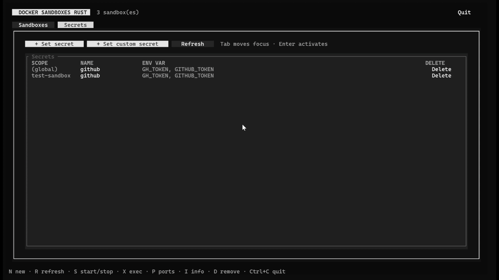

# sbx-rust-tui




A simple terminal UI (TUI) for easily managing Docker Sandboxes and publishing ports, without leaving your terminal.

## Why?

The built-in Docker Sandboxes TUI covers the basics, but leaves out finer configuration, pushing you back into CLI flags or extra steps when setting resources or managing ports. `sbx-rust-tui` gives you hands-on control over local sandbox creation, workspaces, and port publishing right from your terminal.

## Features

### Sandboxes

- Browse sandboxes and see their current status
- Create sandboxes with your choice of agent, CPUs, memory, and disk size
- Pick a workspace folder with a built-in folder browser, then mount or clone it
- Start, stop, and remove sandboxes with confirmation prompts
- Open a shell inside a running sandbox
- Publish and inspect ports in a dialog, including publishing a host-to-sandbox port mapping and unpublishing existing mappings
- View live sandbox details, including CPU, memory and disk usage, agent configuration, and mounted host paths

### Secrets

- Browse secrets from the global store and from every sandbox in a dedicated Secrets tab, with scope, service name, and environment variable details
- Inspect a secret's details, including its environment variables and API domains
- Set a secret for a supported service in either the global scope or a specific sandbox
- Set custom secrets with an environment key, value, and one or more target hosts

## Installation

You need [Rust](https://rustup.rs/) and the `sbx` CLI available on your `PATH`.

```sh
git clone https://github.com/CamielYang/sbx-rust-tui.git
cd sbx-rust-tui
cargo install --path .
```

Then run:

```sh
sbx-rust-tui
```

For a development build, use `cargo run` from the project directory instead.

## Platform Support & Build Testing

The build has been mainly tested on **Windows** and **Linux**. Please be aware that **macOS** have not yet been tested and may encounter minor issues.
