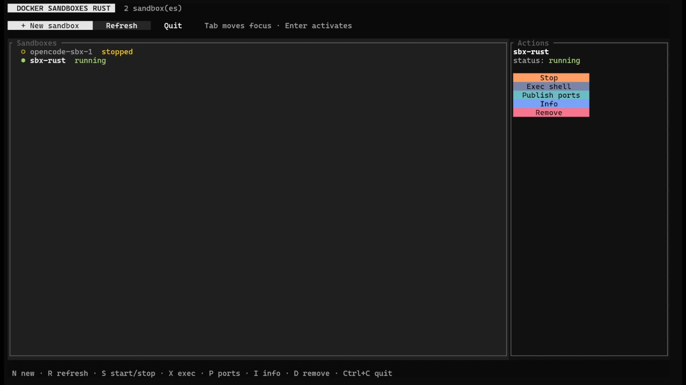

# sbx Rust TUI



A simple terminal UI (TUI) for easily managing Docker Sandboxes and publishing ports, without leaving your terminal.

## Why?

The built-in Docker Sandboxes TUI covers the basics, but leaves out finer configuration, pushing you back into CLI flags or extra steps when setting resources or managing ports. `sbx-rust-tui` gives you hands-on control over local sandbox creation, workspaces, and port publishing right from your terminal.

## Features

- Browse sandboxes and see their current status
- Create sandboxes with your choice of agent, CPUs, memory, and disk size
- Pick a workspace folder with a built-in folder browser, then mount or clone it
- Start, stop, and remove sandboxes with confirmation prompts
- Open a shell inside a running sandbox
- Publish and inspect ports with a simple dialog
- View live sandbox details and resource usage
- Navigate with the keyboard or mouse

## Installation

You need [Rust](https://rustup.rs/) and the `sbx` CLI available on your `PATH`.

```sh
git clone <your-repository-url>
cd sbx-rust-tui
cargo install --path .
```

Then run:

```sh
sbx-rust-tui
```

For a development build, use `cargo run` from the project directory instead.

## Release builds

Use [just](https://github.com/casey/just) to build for Windows, Linux and macOS:

```sh
just setup    # install Rust targets, cargo-zigbuild and zig (once)
just release
```

The `dist/` folder then contains only the executables:

```
sbx-rust-tui-windows.exe
sbx-rust-tui-linux
sbx-rust-tui-darwin
```

`just build-windows`, `just build-linux` and `just build-darwin` build a single
platform; `just clean` removes `dist/`.
